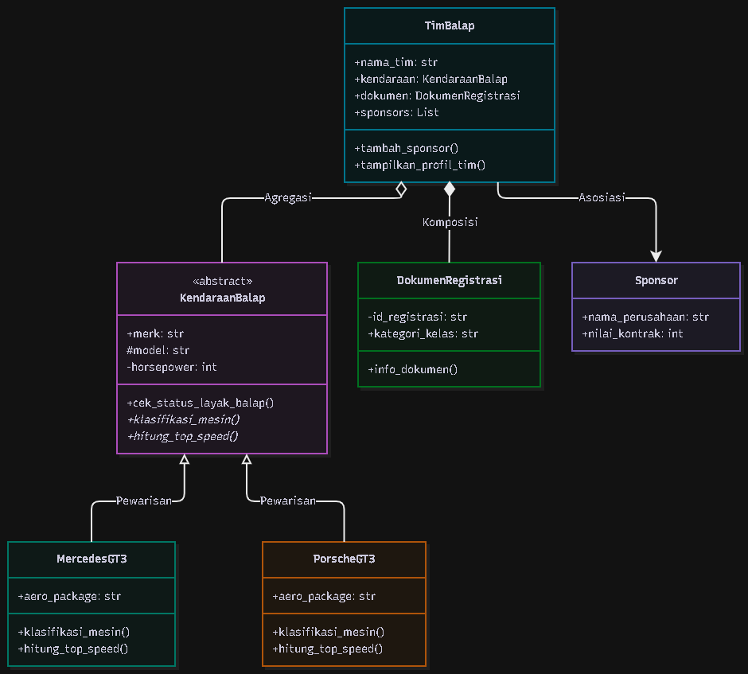
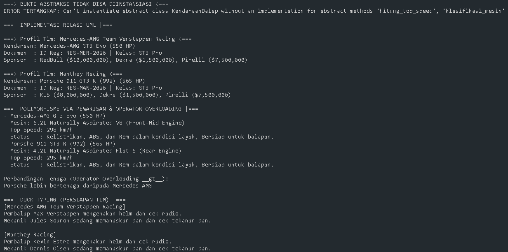

# Sistem Manajemen Data Registrasi Tim dan Klasifikasi Spesifikasi Kendaraan Balap Ketahanan Kelas GT3

**Deskripsi Singkat:** 
Program ini merupakan simulasi sistem manajemen registrasi untuk tim balap ketahanan (Endurance Racing) kelas GT3. Sistem ini memanajemen data tim (seperti Mercedes-AMG Team Verstappen Racing & Manthey Racing), data sponsor, dokumen registrasi, serta mengklasifikasikan spesifikasi mesin dari kendaraan balap (Mercedes AMG GT3 dan Porsche 911 GT3R) menggunakan prinsip Object-Oriented Programming (OOP).

---

## 1. Class Diagram & Relasi (UML)

**Penjelasan Relasi:**
1. **Asosiasi (`TimBalap` dengan `Sponsor`)**: Relasi sejajar di mana Tim Balap *menggunakan/bekerja sama* dengan Sponsor (seperti RedBull, KUS, Dekra, Pirelli). Jika kontrak habis, Tim Balap dan Sponsor tetap eksis secara independen di luar program.
2. **Agregasi (`TimBalap` dengan `KendaraanBalap`)**: Relasi "Has-A" yang longgar. `KendaraanBalap` diinstansiasi di luar kelas `TimBalap` lalu dimasukkan (di-inject) ke dalamnya. Jika tim balap bubar, fisik mobil tersebut masih ada dan bisa dijual/digunakan tim lain.
3. **Komposisi (`TimBalap` dengan `DokumenRegistrasi`)**: Relasi "Part-Of" yang kuat. `DokumenRegistrasi` diinstansiasi di *dalam* constructor `TimBalap`. Jika entitas Tim dihapus dari sistem, dokumen registrasinya otomatis hangus dan hancur karena tidak ada artinya tanpa tim tersebut.

---

## 2. Penerapan Abstraksi
Program ini menggunakan Abstract Base Class (ABC) pada kelas `KendaraanBalap`.
- **Abstract Method**: Terdapat dua abstract method wajib yaitu `klasifikasi_mesin()` dan `hitung_top_speed()`. Method ini memaksa subclass (MercedesGT3 dan PorscheGT3) untuk memberikan implementasi spesifik mesin dan kecepatannya sendiri.
- **Method Konkret**: Terdapat method `cek_status_layak_balap()` di dalam abstract class yang langsung dipakai (diwariskan) oleh semua subclass tanpa harus ditulis ulang.
- **Bukti Tidak Bisa Diinstansiasi**: Pada blok eksekusi utama, terdapat blok `try-except`. Saat program mencoba melakukan `KendaraanBalap("Lamborghini", "Huracan", 580)`, program memunculkan pesan `TypeError` karena kelas abstrak tidak dapat dibuat menjadi objek secara langsung.

---

## 3. Penerapan Polimorfisme
1. **Polimorfisme via Pewarisan**: Method `klasifikasi_mesin()` dan `hitung_top_speed()` di-override oleh kelas `MercedesGT3` dan `PorscheGT3`. Saat dipanggil menggunakan perulangan (`for mobil in koleksi_mobil:`), setiap objek merespon dengan output spesifikasi mesin (V8 vs Flat-6) yang berbeda sesuai kelas asalnya, tanpa perlu menggunakan rantai `if/elif`.
2. **Duck Typing**: Terdapat kelas `Pembalap` (Max Verstappen, Kevin Estre) dan `Mekanik` (Jules Gounon, Dennis Olsen). Keduanya tidak memiliki hubungan pewarisan, namun memiliki nama method yang sama yaitu `persiapan_sesi()`. Keduanya dapat dipanggil secara fleksibel oleh satu fungsi yang sama yaitu `jalankan_persiapan(aktor)`.
3. **Operator Overloading**: Kelas `KendaraanBalap` mengimplementasikan *magic method* `__str__` agar objek mengembalikan format string spesifikasi yang rapi saat di-print. Selain itu, digunakan magic method `__gt__` (Greater Than / `>`) untuk membandingkan Horsepower (HP) dari dua mobil secara langsung dengan operator matematika (contoh: `mobil_porsche > mobil_mercedes`).

---

## 4. Nilai Plus: Penerapan Prinsip SOLID
Program ini menerapkan **Dependency Inversion Principle (DIP)** dari SOLID:
- **Penerapan**: Pada kelas `TimBalap`, inisialisasi `KendaraanBalap` tidak dilakukan secara "hardcoded" di dalam constructor `TimBalap`. Objek `KendaraanBalap` (Mercedes atau Porsche) dibuat di luar, lalu disuntikkan (di-*inject*) melalui parameter (Dependency Injection).
- **Alasan & Manfaat**: Memenuhi prinsip *High-level modules should not depend on low-level modules*. Jika kedepannya ada perubahan tipe mobil (misal ingin mengganti ke Aston Martin Vantage GT3), kita tidak perlu membongkar/memodifikasi kode inti di dalam kelas `TimBalap`.

---

## 5. Screenshot Output Program

